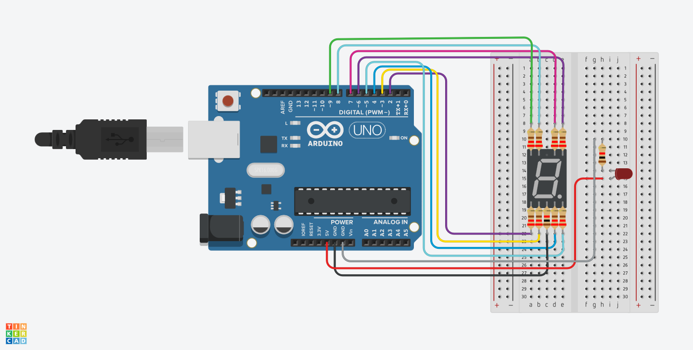

# Forza Horizon 5 Arduino Sim Racing Dashboard

A custom, low-latency DIY sim racing dashboard built from scratch. This project captures live UDP telemetry streams directly from **Forza Horizon 5**, parses real-time vehicle data using Python, and drives an Arduino Uno wired to a 7-segment gear display and an RPM-triggered shift light LED.

---

## Features

* **Direct UDP Telemetry Capture:** Listens to real-time game telemetry packets from FH5 over local loopback.
* **Python Telemetry Bridge:** Low-overhead data parsing using `socket`, `struct`, and `pyserial`.
* **7-Segment Gear Indicator:** Real-time tracking for Reverse, Neutral, and forward gears using Common Cathode logic.
* **Dynamic Shift Light:** Automatically triggers an external LED alert when reaching 88% of the engine redline.
* **Zero-Latency Optimization:** Streamlined execution loop with non-blocking sockets and immediate serial write buffers.

---

## Hardware Requirements

* **Arduino Uno** (or compatible microcontroller)
* **7-Segment Display** (Common Cathode)
* **Single LED** (for the RPM shift light)
* **Jumper Wires & Breadboard**

---

## Schematics

  
---

## Requirements
Make sure you have Python installed along with the required serial library:
```bash
pip install pyserial
